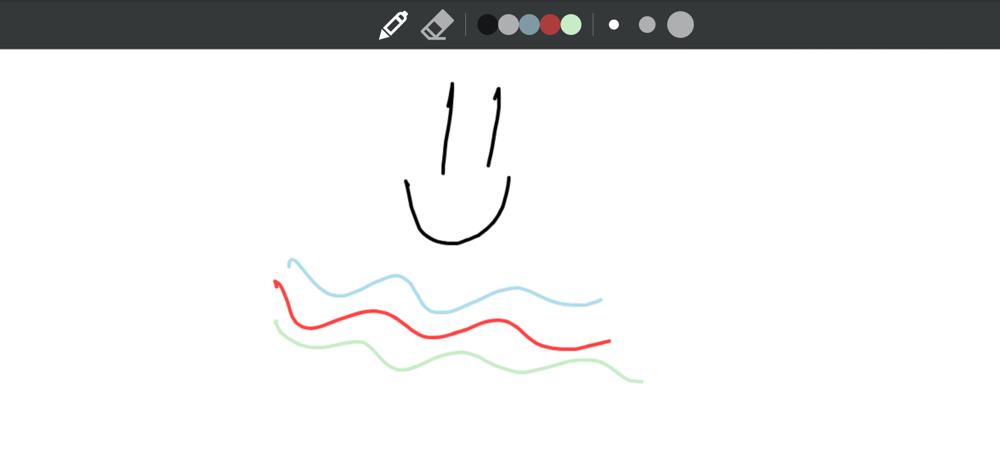
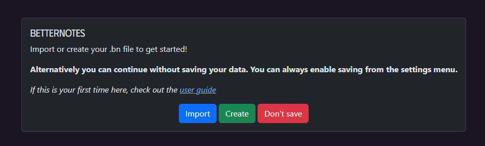
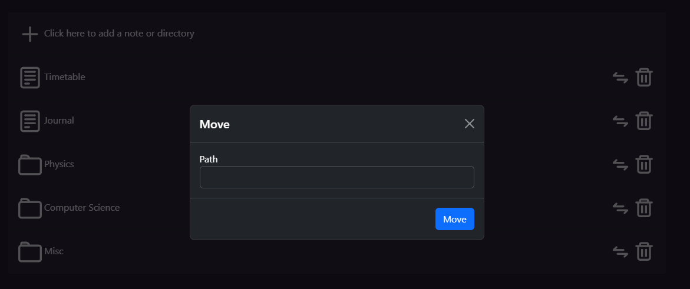
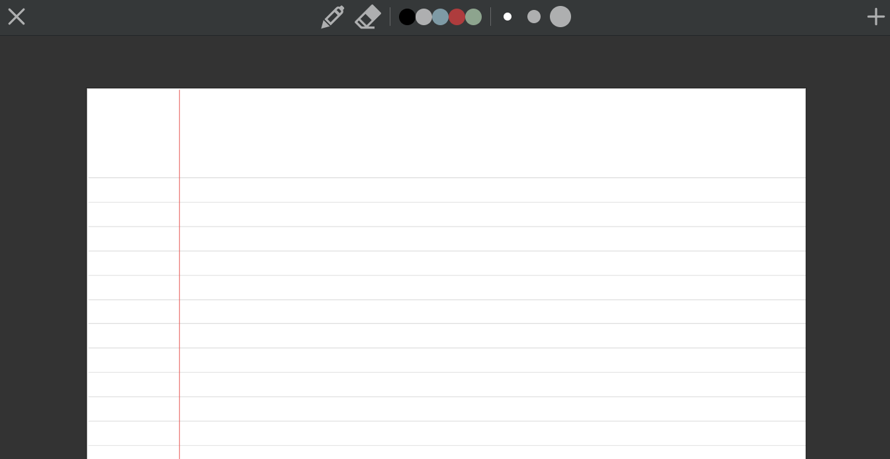

<div align="center">

# BetterNotes



Lightweight, browser-based note-taking with a canvas editor, page templates, folders, search, and automatic saving to a single `.bn` file.

</div>

- App source: [app/](app)
- Entry HTML: [app/index.html](app/index.html)
- Main code: [app/src/main.ts](app/src/main.ts)
- UI modals: [app/src/modal.ts](app/src/modal.ts)
- Styles: [app/src/style.css](app/src/style.css)
- Templates (PDF): [Templates/](Templates)
- User guide: [docs/BetterNotes User Guide.md](docs/BetterNotes%20User%20Guide.md)
- GitHub Pages deploy: [.github/workflows/gh-pages.yml](.github/workflows/gh-pages.yml)

## Features

- Canvas editor (pen, eraser, colors, thickness, add pages)
- Page templates: White/Yellow/Dark (Plain/Lined/Grid)
- Folder-like document interface (create notes/directories, move, delete, search)
- Automatic saving to a `.bn` file; manual import/export available
- Desktop and mobile support (including Apple Pencil)

## Screenshots

- Start screen: 
- Document interface: 

- Canvas editor: 

## Quick start (development)

Prereqs: Node.js 18+, pnpm

```bash
# From repository root
cd app
pnpm install

# Start dev server
pnpm dev

# Build production bundle (outputs to app/dist)
pnpm build

# Preview production build
pnpm preview
```
